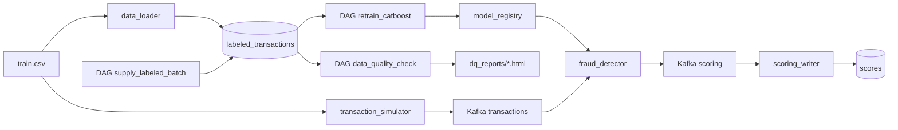

# Антифрод: поток транзакций, скоринг и переобучение в Airflow

Сервис скоринга фродовых транзакций с переобучением по расписанию. Kafka несёт поток транзакций, CatBoost скорит их опубликованной моделью, Airflow дописывает размеченные месяцы в витрину, переобучает модель на скользящем окне, раскатывает её только если она не хуже текущей и проверяет качество данных.

Датасет — `train.csv` из соревнования [teta-ml-1-2025](https://www.kaggle.com/competitions/teta-ml-1-2025/data).

---

## Архитектура



| Сервис | Описание |
|--------|----------|
| **Kafka + Zookeeper** | Шина сообщений: топики `transactions` и `scoring` |
| **Kafka UI** | Просмотр топиков, http://localhost:8080 |
| **transaction_simulator** | Каждые 0.1 с шлёт в `transactions` случайную строку CSV с новым `transaction_id` и текущим временем |
| **fraud_detector** | Препроцессинг и инференс CatBoost. Перед каждым сообщением читает `/models/latest.txt` и при смене версии загружает `my_catboost_<версия>.cbm` — без перезапуска контейнера |
| **scoring_writer** | Пишет `score`, `fraud_flag`, `model_version` из топика `scoring` в таблицу `scores` |
| **PostgreSQL** | Витрина `labeled_transactions`, состояние окна `training_state`, результаты `scores` |
| **data_loader** | Один раз загружает CSV в витрину и собирает стартовое окно обучения (январь–апрель 2019) |
| **airflow** | Три DAG: поставка месяца, переобучение, проверка качества данных. UI — http://localhost:8081 |

Каталог моделей — общий том `model_registry`: в Airflow он смонтирован как `/opt/airflow/models`, в `fraud_detector` — как `/models`. Рядом с ним в Airflow лежит каталог отчётов качества `/opt/airflow/dq_reports`, он же смонтирован на хост в `./dq_reports`.

---

## Структура проекта

```
.
├── dags/                         # только сборка графов
│   ├── supply_labeled_batch.py   # поставка нового месяца в витрину
│   ├── retrain_catboost.py       # переобучение и раскатка модели
│   └── data_quality_check.py     # проверка качества данных
├── pipeline/                     # функции задач
│   ├── settings.py               # пути и параметры (окно, батч, глубина истории, метрика)
│   ├── db.py                     # витрина и training_state
│   ├── supply/                   # задачи поставки месяца
│   ├── retrain/                  # задачи переобучения, метрики, сравнение с текущей моделью
│   └── dq/                       # правила качества данных и HTML-отчёт
├── fraud_detector/
│   ├── src/preprocessing.py      # препроцессинг (общий для обучения и скоринга)
│   ├── src/scorer.py             # загрузка актуальной модели и скоринг
│   ├── models/my_catboost.cbm    # стартовая модель
│   └── tools/train_initial_model.py
├── transaction_simulator/  scoring_writer/  data_loader/  airflow/
├── data/                         # сюда кладётся train.csv
├── dq_reports/                   # HTML-отчёты качества данных
├── docker-compose.yaml
└── .env.example
```

---

## Запуск

Нужны Docker и Docker Compose v2. Для контейнеров нужно ~6 ГБ свободной памяти.

1. Клонировать репозиторий и перейти в папку проекта.

2. Скачать `train.csv` с [Kaggle](https://www.kaggle.com/competitions/teta-ml-1-2025/data) и положить в `data/train.csv`.

3. Создать `.env` из шаблона (путь к CSV там уже указан: `./data/train.csv`):

   ```bash
   cp .env.example .env
   ```

4. Поднять контейнеры:

   ```bash
   docker compose up -d --build
   ```

   Первый запуск скачивает образы и загружает витрину, это занимает несколько минут. Airflow стартует после того, как `data_loader` загрузит данные. Проверить статус:

   ```bash
   docker compose ps
   ```

## Где что смотреть

| Что | Где |
|-----|-----|
| Airflow UI | http://localhost:8081, логин `admin`, пароль `admin` |
| Kafka UI | http://localhost:8080, топики `transactions` и `scoring` |
| PostgreSQL | `localhost:5432`, база `fraud_db`, `fraud_user` / `fraud_pass` |
| Отчёты качества данных | `./dq_reports/latest.html` (и история `dq_report_<месяц>_<время>.html`) |
| Модели | `docker compose exec airflow ls -la /opt/airflow/models` |

---

## DAG

Все DAG запускаются каждые 5 минут (`*/5 * * * *`), `catchup=False`, `max_active_runs=1`. Ручной запуск — кнопка ▶ (Trigger DAG) в UI Airflow или:

```bash
docker compose exec airflow airflow dags trigger retrain_catboost
```

### `supply_labeled_batch` — поставка нового месяца

`sample_next_month` → `append_labeled_batch` → `prune_old_months`

Берёт **50 000** случайных строк витрины, переносит их `transaction_time` в месяц, следующий за последним в витрине (день, час и минута сохраняются), и дописывает батч. Затем удаляет наблюдения старше **2 лет** относительно самого нового месяца. Первый поставленный месяц — апрель 2020 (CSV заканчивается мартом 2020).

### `retrain_catboost` — переобучение

```
extract_month_batch → slide_training_window → time_train_test_split → preprocess_dataset
  → fit_catboost → evaluate_against_champion → choose_deploy ─┬─ publish_model ─┬─ commit_training_window
                                                              └─ reject_model ──┘
```

- **Окно — 4 месяца, скользящее.** Каждый запуск берёт из витрины месяц по указателю `training_state.next_batch_month` (начиная с мая 2019), добавляет его в окно и убирает самый старый месяц.
- **Split по времени:** три ранних месяца окна — train, самый свежий — test. Для ранней остановки CatBoost берётся хвост train (последние 15% по времени), test-месяц в обучении не участвует.
- **Повтор после ошибки безопасен.** Новое окно сначала пишется в `pending_window.parquet`, `current.parquet` и указатель месяца обновляет только последняя задача `commit_training_window`. Она запускается после сохранения модели и проверяет, что файл модели существует. `training_state` выставляется абсолютными значениями от месяца батча, поэтому повторный запуск не сдвигает окно второй раз и не пропускает месяц.
- Если следующего месяца в витрине нет, задачи помечаются как skipped.

### `data_quality_check` — качество данных

`extract_dq_sample` → `run_dq_checks` → `publish_dq_report` → `fail_on_critical`

Проверяет самый свежий месяц витрины (то, что последним попало в данные для обучения), публикует HTML-отчёт в `./dq_reports` и помечает прогон упавшим, если не прошло хоть одно критичное правило. Отчёт публикуется до этой проверки, поэтому он доступен и при ошибке.

---

## Препроцессинг

`fraud_detector/src/preprocessing.py`, функция `run_preproc`. Одна и та же функция используется в DAG и в онлайн-скоринге. Все признаки считаются построчно, без статистик обучающей выборки, поэтому одно сообщение из Kafka обрабатывается так же, как батч при обучении.

| Признак | Как считается |
|---------|---------------|
| `hour`, `hour_sin`, `hour_cos` | час операции и его циклическое кодирование |
| `day_of_week`, `is_weekend`, `is_night` | день недели, выходной, ночь (22:00–5:59) |
| `log_amount`, `is_round_amount`, `is_large_amount` | log(1 + сумма), сумма без копеек, сумма > 500 |
| `distance_km` | расстояние клиент — мерчант по формуле гаверсинусов |
| `log_city_pop`, `amount_per_log_pop` | размер города в лог-шкале, сумма относительно размера города |
| `merch` | имя мерчанта без служебного префикса `fraud_` |
| `cat_daypart` | категория × часть суток (ночь/утро/день/вечер) |
| `cat_id`, `gender`, `one_city`, `us_state`, `jobs` | категориальные признаки CatBoost |

Удаляются: имена, улица, индекс, сырые координаты, население города и время (они заменены производными признаками).

---

## Проверка улучшения модели

Задача `evaluate_against_champion` сравнивает новую модель (challenger) с опубликованной (champion — версия из `latest.txt`):

1. Обе модели скорят **один и тот же test-месяц** — самый свежий месяц окна. Ни одна из них его не видела: champion обучен на окне, которое заканчивается предыдущим месяцем, challenger использует этот месяц только для проверки.
2. Основная метрика — **PR-AUC** (average precision). Доля фрода меньше 1%, на таком дисбалансе ROC-AUC близок к 1 у любых разумных моделей и плохо их различает. PR-AUC показывает качество на редком положительном классе. Дополнительно в метрики пишутся ROC-AUC, F1, precision и recall при пороге 0.5.
3. Решение: `PR-AUC(new) >= PR-AUC(champion) - MIN_IMPROVEMENT` (сейчас `MIN_IMPROVEMENT = 0`, то есть новая модель не должна быть хуже).
   - Не хуже → `publish_model`: `my_catboost_<version>.cbm` + `.metrics.json` в каталог моделей, атомарная замена `latest.txt`.
   - Хуже → `reject_model`: модель и метрики сохраняются в `models/rejected/`, `latest.txt` не меняется, сервис продолжает скорить прежней моделью.
4. Если champion нельзя оценить (нет `latest.txt` или модель несовместима с признаками), новая модель публикуется.

Окно и указатель месяца сдвигаются в обоих случаях: месяц уже использован, а отказ в раскатке не должен останавливать переобучение на следующих месяцах. В `.metrics.json` каждой модели записаны её метрики, метрики champion на том же месяце и причина решения.

Стартовая модель (`fraud_detector/models/my_catboost.cbm`, версия `initial`) — простой бейзлайн: обучена на январе 2019, 100 итераций (`fraud_detector/tools/train_initial_model.py`). Она скорит поток до первой публикации и служит первым champion.

---

## Правила качества данных

Правила описаны в `pipeline/dq/rules.py`. Проверяется самый свежий месяц `labeled_transactions`.

| ID | Правило | Требование | Критичность |
|----|---------|-----------|-------------|
| DQ1 | Схема витрины | присутствуют все 18 колонок | critical |
| DQ2 | Полнота ключевых полей | доля пропусков в `transaction_time`, `amount`, `cat_id`, `us_state`, координатах и `target` ≤ 1% | critical |
| DQ3 | Допустимые значения target | `target ∈ {0, 1}` | critical |
| DQ4 | Диапазон суммы | `0 < amount ≤ 50 000` | critical |
| DQ5 | Корректность координат | широта ∈ [-90, 90], долгота ∈ [-180, 180] для клиента и мерчанта | critical |
| DQ6 | Справочные значения | `gender ∈ {M, F}`, `us_state` — две заглавные буквы, `cat_id` из справочника 14 категорий | critical |
| DQ7 | Время внутри месяца | нет пустых `transaction_time`, все значения в пределах проверяемого месяца | critical |
| DQ8 | Объём месяца | ≥ 10 000 строк | warning |
| DQ9 | Доля мошенничества | доля `target = 1` в диапазоне [0.1%, 3%] | warning |
| DQ10 | Дубликаты | доля полностью совпадающих строк ≤ 1% | warning |

Статус отчёта: `PASSED` — всё прошло, `WARNING` — не прошли только warning-правила, `FAILED` — не прошло критичное правило (задача `fail_on_critical` падает).

---

## Параметры

Задаются в `pipeline/settings.py`.

| Параметр | Значение |
|----------|----------|
| Окно обучения `WINDOW_MONTHS` | 4 месяца (3 train + 1 test) |
| Размер батча поставки `SAMPLE_SIZE` | 50 000 строк |
| Глубина истории витрины `HISTORY_YEARS` | 2 года |
| Метрика раскатки `PRIMARY_METRIC` | PR-AUC |
| Допуск `MIN_IMPROVEMENT` | 0 |
| Расписание DAG | каждые 5 минут |

---

## Проверка работы

1. **DAG видны в UI.** Открыть http://localhost:8081 (`admin` / `admin`). Там будут `supply_labeled_batch`, `retrain_catboost`, `data_quality_check`. В `retrain_catboost` → Graph видна цепочка задач с ветвлением.

2. **Ручной запуск.** Нажать ▶ у `retrain_catboost` (или команда `airflow dags trigger` выше). Прогон занимает около минуты.

3. **Новый файл модели в общем каталоге:**

   ```bash
   docker compose exec airflow ls -la /opt/airflow/models /opt/airflow/models/rejected
   ```

   ```bash
   docker compose exec airflow cat /opt/airflow/models/latest.txt
   ```

   Метрики и решение по каждой модели:

   ```bash
   docker compose exec airflow sh -c 'cat /opt/airflow/models/*.metrics.json'
   ```

4. **Сервис скорит опубликованной версией.** Версия модели передаётся в сообщении топика `scoring` (поле `model_version`, видно в Kafka UI) и записывается в таблицу `scores`:

   ```bash
   docker compose exec postgres psql -U fraud_user -d fraud_db -c "SELECT model_version, count(*), max(created_at) FROM scores GROUP BY model_version ORDER BY max(created_at) DESC;"
   ```

   После публикации новые строки получают версию из `latest.txt`, а контейнер `fraud_detector` при этом не перезапускается. В логах видно момент переключения:

   ```bash
   docker compose logs fraud_detector | grep "Загружена модель"
   ```

5. **Окно обучения сдвинулось:**

   ```bash
   docker compose exec postgres psql -U fraud_user -d fraud_db -c "SELECT * FROM training_state;"
   ```

6. **Поставка месяца и качество данных.** Запустить `supply_labeled_batch`, затем `data_quality_check` и открыть `./dq_reports/latest.html` в браузере. Новый месяц в витрине:

   ```bash
   docker compose exec postgres psql -U fraud_user -d fraud_db -c "SELECT date_trunc('month', transaction_time) m, count(*) FROM labeled_transactions GROUP BY m ORDER BY m DESC LIMIT 5;"
   ```

## Остановка

```bash
docker compose down
```

`docker compose down -v` дополнительно удаляет витрину, состояние окна, модели и состояние Airflow: следующий запуск начнёт всё заново.
